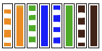
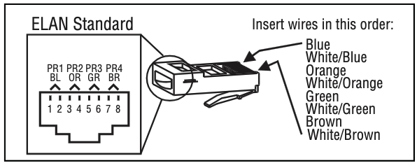
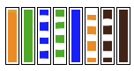
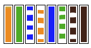

# ELAN hardware wiring

These diagrams document the wiring in the tested setup:

```text
gSC10 controller ──[Cable 2: RS232]── Adapter 1

SC1 RS232 ──[Cable 3: RS232]── Adapter 2
   │
   └────[Cable 1: ViaNet]──── s1616A amplifier
```

All diagrams are recorded with the **pins away and the latch facing away**.
Keep that orientation when reading the pin order.

## Cable 1 — ViaNet: s1616A to SC1

### Amp ViaNet IN / SC1 ViaNet OUT



The physical cable is straight-through. The TIA-568B color order shown above
has worked in the tested setup.

### ELAN’s documented ViaNet order



The ELAN documentation specifies its own order:

| Pin | ELAN conductor color |
| ---: | --- |
| 1 | Blue |
| 2 | White/blue |
| 3 | Orange |
| 4 | White/orange |
| 5 | Green |
| 6 | White/green |
| 7 | Brown |
| 8 | White/brown |

The differential pairs are kept together to reduce electrical interference.
In this installation, TIA-568B on both ends has operated without apparent
issues, but ELAN’s documented order is the reference when troubleshooting.

## Cable 2 — gSC10 RS232

### gSC10 Port 1


### Adapter 1



## Cable 3 — SC1 RS232

### SC1 RS232


### Adapter 2



## Build and test notes

- Confirm the connector orientation before crimping or probing a cable.
- Verify continuity with a multimeter before connecting the controller or
  amplifier.
- Do not assume another ELAN amplifier or SC1 revision uses the same wiring.
- The attached images are the source-of-truth diagrams from the exported
  AnyBlock document; the tables above are only a readable transcription of
  the documented ViaNet order.

Reference: [ELAN SC1 documentation](https://www.elanportal.com/supportdocs/catalog/SC1.pdf).

